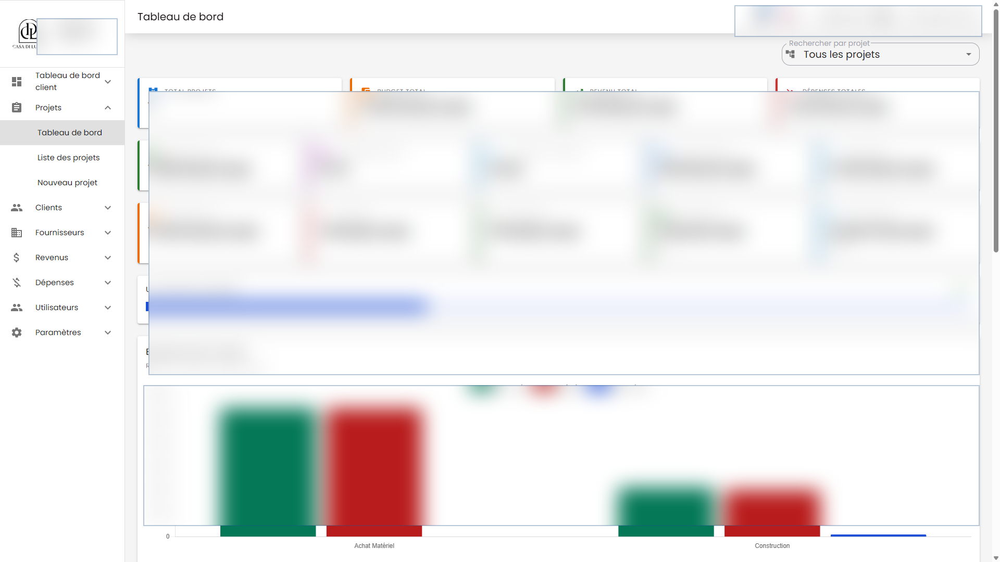
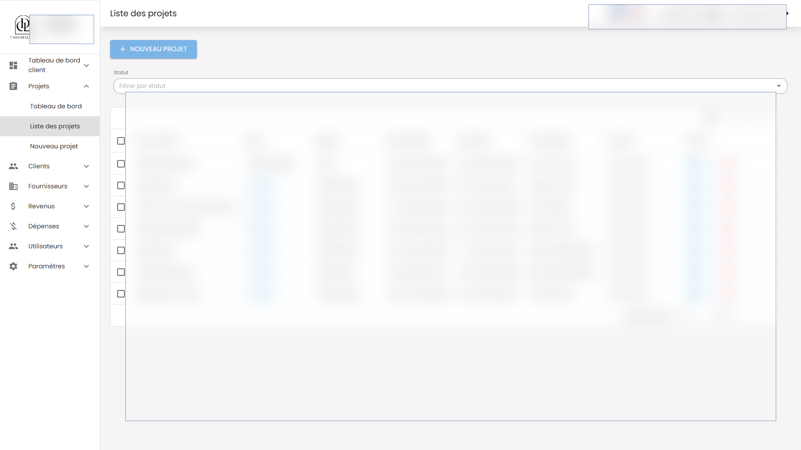

# Management Projet Backend

Django REST API for a project operations platform for clients, suppliers, projects, expenses, revenues, attachments, budgets, payment schedules, dashboards, notifications, and user management.

This is a production-oriented business backend. It models real operational workflows, authenticated staff access, API filtering, document/report generation, realtime notification plumbing, and testable domain behavior.

## What It Shows

- Backend ownership for a complete internal business application.
- Django REST API design across related business modules.
- PostgreSQL data modeling for operational records and audit/history needs.
- Auth, permissions, SSO subject handling, filters, dashboards, exports, and realtime events.
- Testable backend code with pytest tooling instead of only manual checks.

## Main Modules

- account
- project
- depense
- revenu
- core
- notification
- ws
- chat_ai

## Key Capabilities

- Django REST API for projects, clients, suppliers, expenses, revenues, attachments, dashboard metrics, and users.
- Project financial model with real budget entries, payment schedules, revenue/expense workflows, supplier records, and document exports.
- PDF generation with ReportLab plus media/file handling for attachments and project documents.
- JWT/session auth, SSO subject support, django-filter, django-axes, and history-aware records.
- Realtime notifications/websocket runtime through Channels, Daphne, Redis, and Celery-ready dependencies.
- pytest coverage around project, revenue, expense, supplier, and dashboard behavior.

- Chat AI Assistant: native authorized searches/financial summaries, owned conversations, bilingual knowledge, and explicitly confirmed audited changes. Deployment remains feature-gated; measured status is in [AI_PROGRESS.md](docs/AI_PROGRESS.md).

## Stack

- Python, Django 6, Django REST Framework
- PostgreSQL, django-filter, django-simple-history
- SimpleJWT, dj-rest-auth, django-axes, CORS
- Redis, Channels, channels-redis, Daphne, Celery-ready runtime
- Gunicorn, WhiteNoise, Pillow/OpenCV where media handling is needed
- pytest, pytest-django, pytest-cov, pytest-asyncio, pytest-xdist

## Related Repository

- Frontend: [Altroo/management_projet_frontend](https://github.com/Altroo/management_projet_frontend)

## Product Screenshots

Redacted production UI screens powered by this API. Sensitive names, amounts, dates, and records are blurred.





## Local Setup

Create local-only environment variables for Django settings, database, Redis, media/static storage, CORS, and allowed hosts. Do not commit `.env` files or production credentials.

```bash
python -m venv .venv
source .venv/bin/activate
pip install -r requirements.txt
python manage.py migrate
python manage.py runserver 8003
```

On Windows, activate with `.venv\Scripts\activate`.

## Tests

```bash
python -m pytest
python -m pytest --cov
```

## Portfolio Note

The repository is public for portfolio review. Screenshots are redacted, and sensitive production values are intentionally hidden.


## Shared business-text provider

The signed private AI gateway supports Groq for translation, grammar correction,
and professional rewriting. Enable each reviewed consumer explicitly with
`AI_GROQ_APPLICATIONS` (comma-separated service names). An enabled consumer fails
closed when credentials are missing; other consumers retain their configured
provider. Keep `GROQ_API_KEY` in the gateway environment only, never in frontend
configuration or Git. This does not enable or modify the independent chat AI.

Default model: `openai/gpt-oss-120b`. Redis atomically shares conservative request
and token budgets across all consumers. Defaults are 28 requests/minute,
900/day, 7000 tokens/minute and 180000/day. Background refreshes can use 80% of
the daily allowance, leaving capacity for user actions. Provider throttles defer
background work; no automatic paid upgrade or local translation fallback occurs.
Quotas can vary by Groq account; configure the limits below the account allowance.

The provider preserves line breaks, blank lines, indentation and list markers
outside model output. It masks names, dimensions, references, amounts and units,
validates restored values and critical construction terminology, and caches
validated masked templates for 30 days. Source French remains authoritative.
No source text, provider response bodies or credentials are logged. Model output
still needs human review for contractual use; validation is not a proof of every
possible semantic equivalence.

Run provider checks with `pytest ai_assistant/test_groq.py ai_assistant/tests.py`.
These use mocked API responses and an ephemeral local Redis instance; they do not
spend provider quota. Historical PDF refreshes remain in each consumer's Celery
queue and can take days under a shared free allowance.


### Saved PDF translations (4.2.3)
Management Projet uses the shared Groq service when `management_projet` is included in `AI_GROQ_APPLICATIONS`. Keep the key in the server's private environment. Saving report text stores durable pending translation rows in the same transaction, then queues Celery work after commit. The existing worker and scheduler drain pending work every minute without changing notification schedules. No model request runs on a save or PDF rendering path. Original fields and monetary values stay unchanged. PDFs wait for validated stored French/English text; quota waits return an informational pending status.

Queue historical report content with `python manage.py translate_pdf_content`; inspect progress with `--status`. The resumable backfill shares the global free-tier budget and leaves capacity for interactive requests. Failed rows retain error codes without logging text. Existing unrelated chat AI flags and models remain unchanged.
